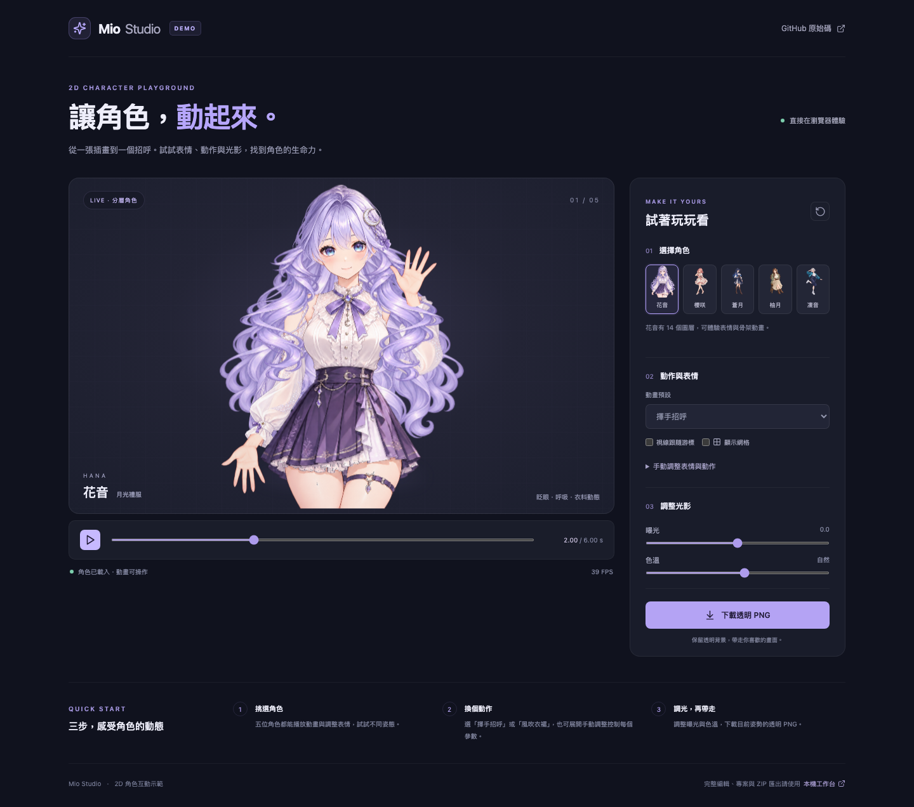
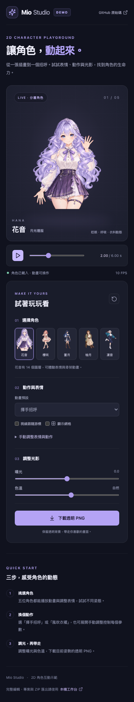

# GitHub Pages Demo

線上網址：[https://lian0123.github.io/new-2d/](https://lian0123.github.io/new-2d/)。

## 操作示意

1. 開啟展示頁，等待左下方出現「角色已載入・動畫可操作」。五位角色都能操作，預設花音會循環播放「揮手招呼」。
2. 點暫停，將時間軸拖曳至 `2.00 s`，檢視抬臂與手腕姿勢；回到 `0.00 s` 可比較原始姿態。
3. 切換「風吹衣襬」或「眨眼微笑」，按播放觀察衣料、髮絲與表情。開啟「顯示網格」可看到變形網格。
4. 勾選「視線跟隨游標」，在角色畫布上移動游標。
5. 調整曝光與色溫，點「下載透明 PNG」取得當前姿勢，透明背景會保留。
6. 選擇其他四位角色時，頁面標示「姿勢動畫」，保留相同的動畫、時間軸、網格、游標與光影控制。展開「手動調整表情與動作」可控制左右眼、嘴型、轉頭、雙手與風力；「恢復動畫控制」會清除手動覆寫。
7. 點右上重設圖示，恢復預設動作、光影與控制；角色選擇保留。

## 實際瀏覽器截圖

桌面：1440px 視窗，花音的揮手動作暫停於 `2.00 s`。



手機：390px 視窗，舞台、播放控制與參數面板依序排列。



## 本機與部署驗證

```sh
npm ci
npx playwright install chromium
npm test
npm run build
npm run build:demo
npm run test:demo
```

測試會自動啟動 `dist-demo/` 的靜態預覽，使用 `/new-2d/` 子路徑測試：

- 載入成功、時間前進、暫停及跳轉，並比較 Canvas 像素確認動作改變。
- 切換動畫、網格與游標追蹤、曝光改變畫面、重設控制。
- 下載真正的 1254 × 1254 RGBA PNG，檢查透明與可見像素。
- 五位角色逐一驗證全部 11 種動畫的畫面變化，以及手動表情、游標追蹤、網格與透明 PNG 匯出。
- 390px 手機版沒有水平溢出，仍能操作與切換角色。
- 素材請求失敗時顯示錯誤並停用下載；恢復素材後可重試。
- 素材使用最多兩個並行傳輸，相同載入中的 URL 共用請求；單張素材 30 秒逾時會顯示錯誤並提供重試。花音的分層模式不再載入未使用的舊手臂素材。

2026-10-14 本機及 GitHub Actions 驗證：27 項單元測試、工作台建置、Demo 建置及 8 項瀏覽器測試全部通過。五位角色共 55 種動作組合均確認畫面變化；四位姿勢角色的所有網格三角形在各預設動作的取樣影格中均維持方向，沒有翻折。2026-10-15 再加入素材並行、去重與失敗恢復測試，共 28 項單元測試通過。以上截圖來自成功的本機瀏覽器測試。

2026-10-14 23:17（Asia/Taipei）另外對實際 GitHub Pages 網址驗證：HTTP 200、花音載入完成、動畫時間前進、暫停並跳轉至 2.00 秒，以及 1254 × 1254 透明 PNG 下載全部成功；沒有 JavaScript 錯誤或失敗的請求。見 [線上驗證報告](demo/online-validation.json) 與 [成功的測試／部署流程](https://github.com/Lian0123/new-2d/actions/runs/38587538992)。
- 正常互動流程沒有 JavaScript 錯誤、失敗的素材請求或 `/api` 請求。

測試截圖儲存在 `test-results/`。CI 會將截圖與失敗時的 trace 上傳為 `demo-browser-qa` artifact，供檢查每次變更。GitHub Pages 發布需先在 repository Settings → Pages 將 Source 設為 GitHub Actions；本機測試通過不能替代實際線上部署驗證。

## 檔案與範圍

### 與花音設計的比較

| 項目 | 花音 | 櫻咲、蒼月、柚月、凜音 |
| --- | --- | --- |
| 美術來源 | 14 個圖層、獨立手臂與表情素材 | 保留原有完整姿勢 PNG |
| 頭部與表情 | 花音的臉部座標與表情貼片 | 每位自己的眼睛、嘴巴與頭部座標；局部表情變形與邊緣融合 |
| 手勢 | 獨立手臂骨架、大幅抬手 | 依原畫肩部與手腕設定連續小幅手勢；柚月雙手與書本一起移動 |
| 頭部、呼吸與風 | 部件與整體網格 | 各自的頭部、胸口、髮絲與衣料區域，腳部與椅子固定 |
| Demo 操作 | 11 種動作、時間軸、手動參數、網格、追蹤、光影及 PNG | 同樣提供上述操作 |

四位角色尚未補繪被遮住的部件，因此手勢保留原本姿態，小幅動態不等同花音的完整部件拆分。舊的 `illustration` 專案仍以靜態插畫方式讀取；Demo 改用新增的 `pose` 模式，不把花音的骨架座標套到其他角色上。

以下為瀏覽器實際渲染的表情操作比較：由左至右是櫻咲、蒼月、柚月、凜音，上排是睜眼／較小嘴型，下排是雙眼閉合／張嘴。測試也逐一比較每位角色 11 種動畫在 0 秒與 2 秒的畫面。


- `demo/index.html`：獨立展示頁入口。
- `src/demo/`：展示控制、樣式，以及依 `BASE_URL` 解析既有素材路徑。
- `src/core/pose-rig.ts`：四位角色各自的動態區域與表情渲染。
- `vite.config.ts`：`demo` 模式輸出 `dist-demo/`；一般模式仍輸出工作台到 `dist/`。
- `.github/workflows/pages.yml`：測試成功才發布，PR 只執行驗證。
- `playwright.demo.config.ts` 與 `tests/demo/`：純靜態 demo 驗證。

Demo 不含本機工作台的專案儲存、麥克風與 ZIP 匯出。這些功能的操作方式見主 README。
